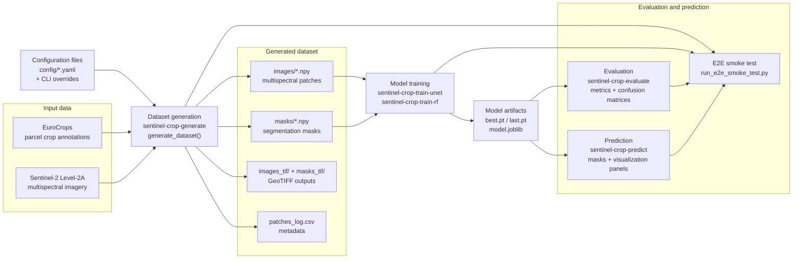
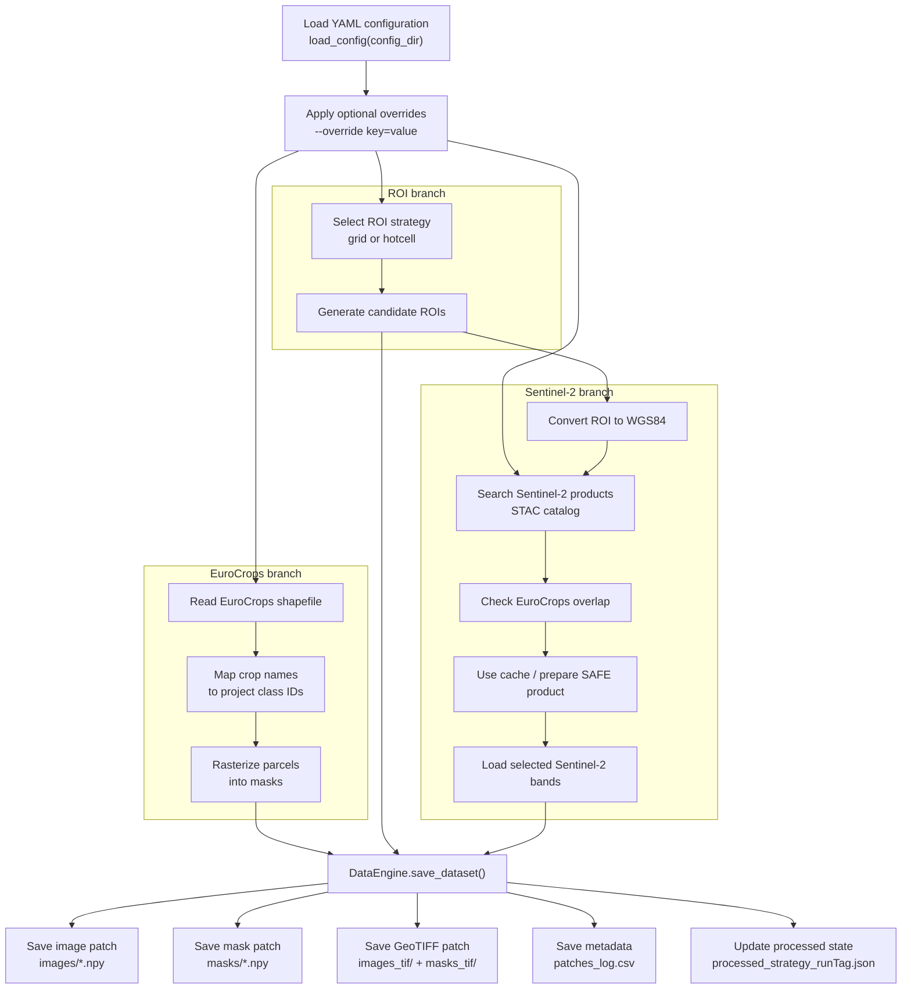
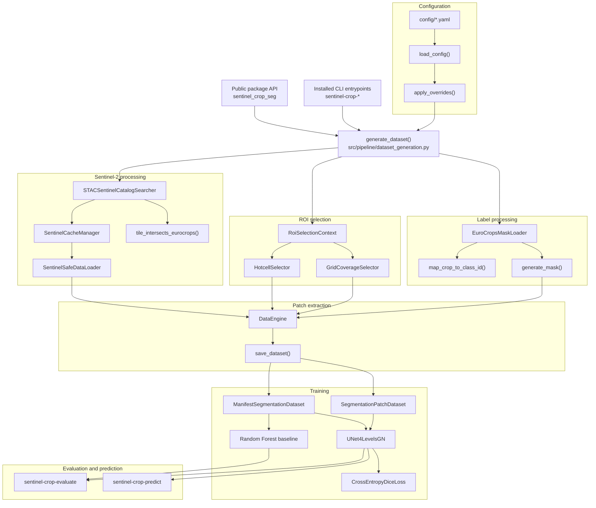
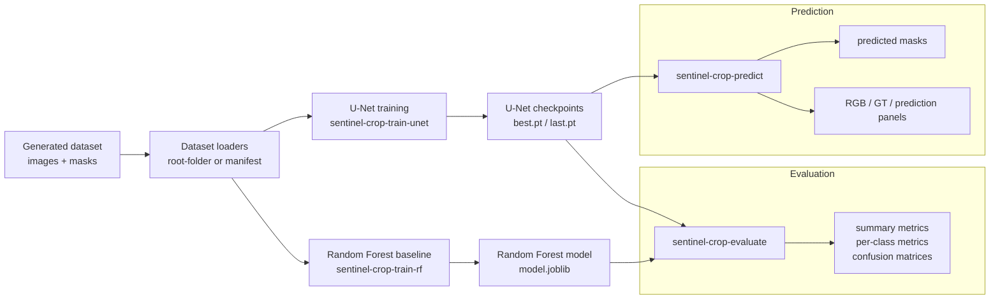
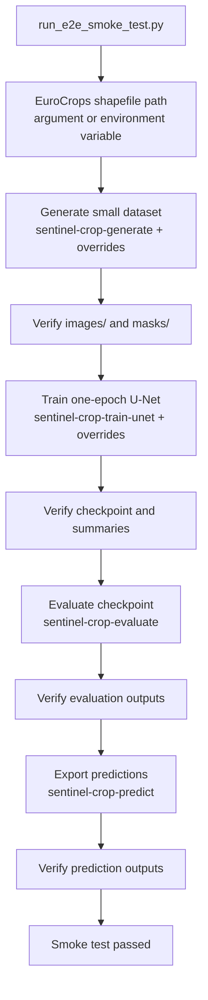

# Project Diagrams

This document contains project-specific diagrams for the Sentinel Crop Segmentation project.

The diagrams are written in Mermaid so they can be rendered directly by GitHub Markdown and exported later as PNG/SVG figures for documentation, thesis writing, or presentations.

---

## 1. High-level project architecture

This diagram shows the main parts of the project without implementation-level details.

### Explanation

The project starts from Sentinel-2 imagery and EuroCrops parcel annotations. Configuration files and runtime overrides define paths, class mappings, ROI strategy, Sentinel search settings, and training parameters.

The dataset generation pipeline produces aligned image-mask pairs saved as NumPy files and GeoTIFF files. The NumPy samples are used for model training, evaluation, and prediction. The GeoTIFF outputs are useful for inspection and geospatial analysis.

---

## 2. Dataset generation pipeline

This diagram focuses on the dataset generation stage.

### Explanation

The dataset generation pipeline combines three branches.

The EuroCrops branch loads parcel annotations, maps heterogeneous crop names to the reduced project taxonomy, and generates raster masks. The ROI branch decides where samples should be extracted, using either the grid strategy or the hotcell strategy. The Sentinel-2 branch searches satellite products, uses the cache to avoid unnecessary repeated downloads, and loads the required spectral bands.

The `DataEngine` combines these inputs and saves aligned image-mask patches.

---

## 3. Main software components

This diagram shows the main components used by `generate_dataset()` and the public CLI tools.

### Explanation

`generate_dataset()` is the orchestration function for dataset generation. It coordinates specialized modules instead of doing all work directly.

`EuroCropsMaskLoader` handles label mapping and mask generation. `GridCoverageSelector` and `HotcellSelector` choose regions of interest. `STACSentinelCatalogSearcher`, `SentinelCacheManager`, and `SentinelSafeDataLoader` handle Sentinel-2 product discovery, caching, and band loading. `DataEngine` extracts final aligned image-mask patches.

The generated dataset is then used by the training and evaluation components.

---

## 4. Training, evaluation, and prediction flow

### Explanation

After dataset generation, the NumPy patches are loaded by root-folder or manifest-based dataset loaders. The U-Net model predicts pixel-level crop classes, while the Random Forest baseline provides a classical machine learning comparison.

The evaluation CLI computes metrics and confusion matrices. The prediction CLI exports masks and optional visualization panels for qualitative inspection.

---

## 5. Minimal E2E smoke test

### Explanation

The E2E smoke test validates that the installed pipeline works end to end. It uses the normal project configuration plus temporary runtime overrides. It is not intended to reproduce full experimental results.

The test checks that dataset generation, training, evaluation, and prediction can run together through the public CLI commands.
